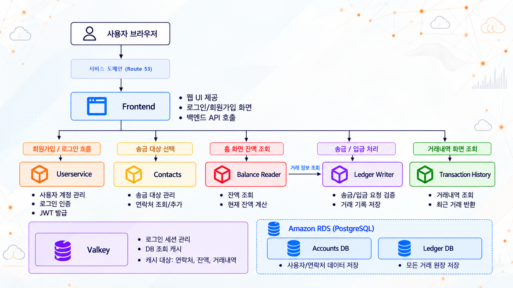
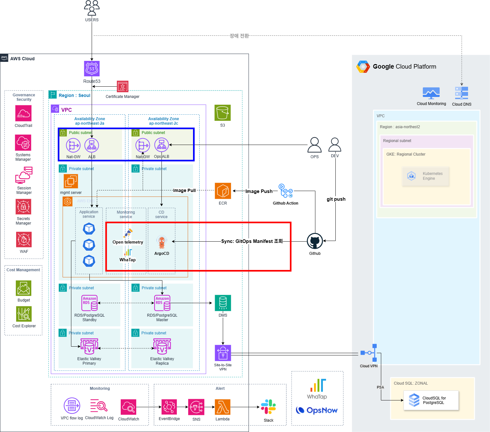
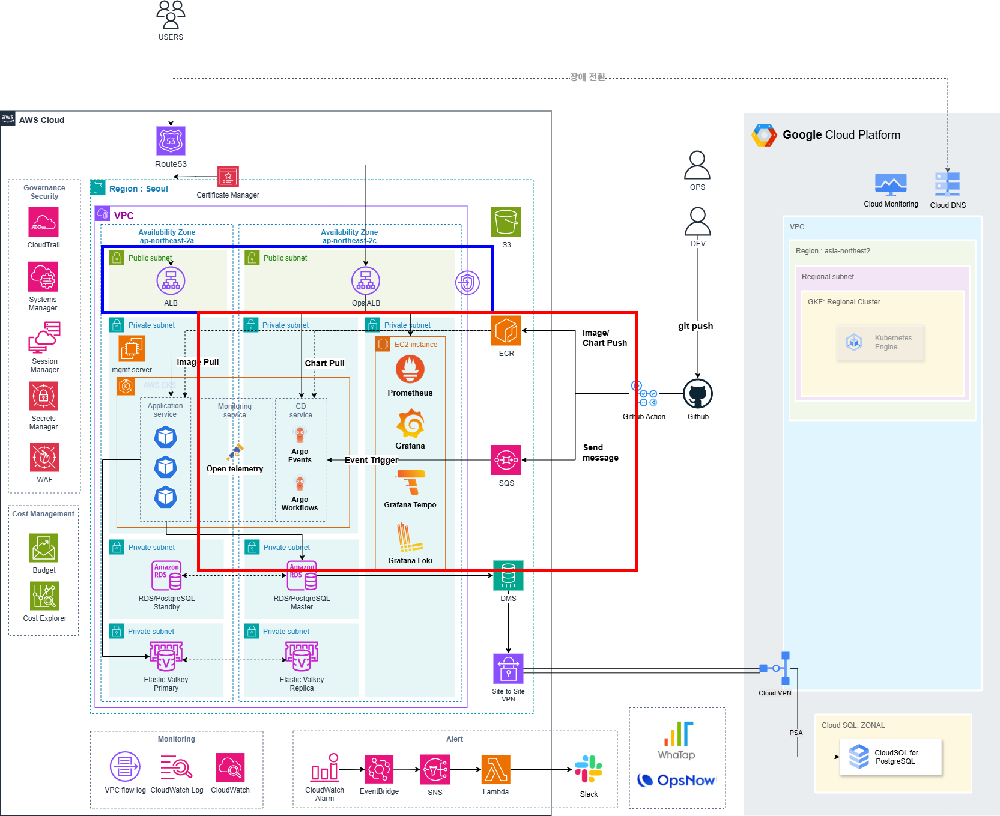
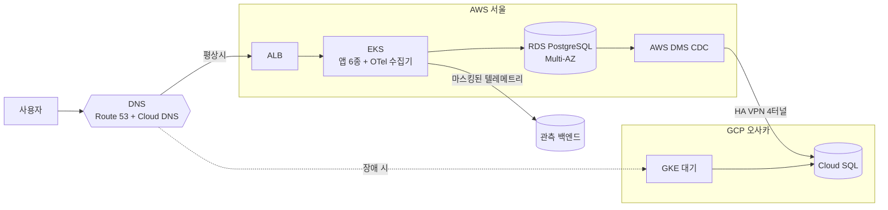

# Bank of Anthos 멀티클라우드 재해복구(DR) — AWS 주 사이트 · GCP 대기 사이트

> KDT 베스핀글로벌 멀티클라우드 엔지니어 부트캠프 4기 · 최종 프로젝트
> 2026.08.31 – 2026.10.02 (5주) · 팀 프로젝트 · **담당 파트: Database(DR) · Observability · Governance**

은행 샘플 앱 Bank of Anthos를 AWS EKS(주 사이트)와 GCP GKE(대기 사이트)에서 운영하고,
**클라우드 하나가 통째로 장애를 일으켜도 서비스를 이어 가는 재해복구 환경**을 구축·시연한 팀 프로젝트입니다.
이 저장소는 그중 **제가 맡은 파트의 설계 결정, 문제 해결, 회고**와 팀 발표 자료를 정리한 문서 저장소입니다.

> 📌 실제 코드는 팀 조직 [AWS-Team1](https://github.com/AWS-Team1)의 저장소에 있습니다. [아래 표](#실제-저장소)에서 바로 이동할 수 있습니다.
> 이 저장소의 문서와 발표 자료에서는 계정 ID · IAM 식별값 · 도메인 같은 식별값을 가렸습니다.

---

## 한눈에 보기

| 항목 | 내용 |
|---|---|
| 목표 | 은행 마이크로서비스를 AWS · GCP 두 클라우드에 걸쳐 운영하고, 클라우드 단위 장애에 대비한 DR을 구축 · 시연 |
| 대상 앱 | Bank of Anthos (Python 3종 · Java 3종), PostgreSQL 2개 DB (accounts · ledger) |
| DR 방식 | Active-Standby (Pilot Light), RDS → AWS DMS CDC → HA VPN → Cloud SQL 단방향 연속 복제 |
| 내 담당 | **Database(DR)** — 복제 도구 선정, DMS · VPN · GCP 대기 사이트 Terraform 루트 **Observability** — OpenTelemetry 무수정 계측, 수집기 마스킹, 대시보드 **Governance** — CloudTrail · 감사 버킷 · EKS audit 감사 체인 |
| 주요 기술 | Terraform · EKS · GKE · RDS · Cloud SQL · AWS DMS · HA VPN · Argo CD · OpenTelemetry · CloudTrail |

## 서비스 구조

## 전체 아키텍처

두 구성을 모두 구축했습니다. ①로 서비스를 먼저 완성한 뒤, 은행권 결제 서비스처럼 **서버의 인터넷 아웃바운드를 제한하는 환경**에서도
운영할 수 있도록 CI/CD와 관측을 다시 설계한 것이 ②이며, PoC 단계까지 진행했습니다.

| 구분 | ① NAT-GW 기반 구성 | ② 아웃바운드 제한 구성 (PoC) |
|---|---|---|
| 목적 | 멀티클라우드 DR 서비스 구축 | 인터넷 아웃바운드 없이 배포 · 운영 |
| 배포 방식 | **Pull** — Argo CD가 GitHub을 조회 | **Push** — GitHub Actions가 ECR · SQS에 전달 |
| 인터넷 출구 | 프라이빗 서브넷 → AZ별 NAT-GW | 없음 — AWS 서비스는 VPC 엔드포인트로 |
| 관측 | OpenTelemetry → WhaTap (외부 SaaS) | Prometheus · Grafana · Tempo · Loki (VPC 내부) |

### ① NAT-GW 기반 구성

| 단계 | 주체 | 동작 |
|---|---|---|
| 1 | GitHub Actions | 앱 이미지를 빌드해 ECR에 push |
| 2 | Argo CD (EKS) | NAT-GW를 거쳐 GitHub의 GitOps 매니페스트를 조회하고 변경분을 동기화 |
| 3 | EKS 노드 | ECR에서 이미지를 받아 서비스 기동 |

- **표준 GitOps** — 클러스터가 Git 저장소를 바라보는 Argo CD 기본 방식이라 구성이 단순합니다.
- **AZ별 NAT-GW** — 프라이빗 서브넷의 외부 통신(GitHub 조회, WhaTap 전송)을 처리합니다.
- **한계** — 클러스터에서 인터넷으로 나가는 경로가 항상 열려 있어, 아웃바운드를 제한하는 환경에는 맞지 않습니다.

### ② 아웃바운드 제한 구성 (PoC)

**배경** — 금융권처럼 서버가 인터넷으로 나가는 경로를 막는 환경에서는 ①의 두 가지가 동작하지 않습니다.
클러스터의 Argo CD가 GitHub을 조회하는 것과, 관측 데이터를 외부 SaaS로 보내는 것입니다.
그래서 클러스터가 밖으로 나가지 않아도 배포 · 관측이 되도록 바꿨습니다.

| 단계 | 주체 | 동작 |
|---|---|---|
| 1 | GitHub Actions | OIDC로 AWS 권한을 받아 매니페스트 렌더링 · 우리 ECR 외 이미지가 있으면 중단 |
| 2 | GitHub Actions | Helm 차트로 묶어 ECR에 push(OCI) · 배포 메시지(커밋 · 차트 버전 · digest)를 SQS로 전송 |
| 3 | Argo Events (EKS) | VPC 엔드포인트로 SQS 메시지를 받아 Argo Workflows 실행 |
| 4 | Argo Workflows (EKS) | ECR의 차트 digest가 메시지와 같은지 검증 → 차트 pull → `helm upgrade --atomic` 배포 |

- **아웃바운드 0** — NAT-GW를 없애고, ECR · SQS 같은 AWS 서비스는 VPC 엔드포인트로만 접근합니다.
- **Pull → Push 전환** — 클러스터가 밖으로 가지러 가는 대신, 외부(GitHub)가 AWS 안의 ECR · SQS에 넣어 두고 클러스터는 꺼내기만 합니다.
- **배포 대상 고정** — 우리 ECR 이미지만 허용하고, 차트 digest가 메시지와 다르면 배포하지 않습니다. 실패하면 자동으로 되돌리고, 동시 배포는 잠금으로 막습니다.
- **관측 내재화** — 외부 SaaS 대신 VPC 안의 Prometheus · Grafana · Tempo · Loki로 지표 · 트레이스 · 로그를 모읍니다.
- **대가** — SQS, Argo Events · Workflows, VPC 엔드포인트, 자체 관측 스택까지 직접 운영할 구성 요소가 늘어납니다.

### DR 요청 흐름

| 구성 요소 | 역할 | 내 기여 |
|---|---|---|
| Terraform 루트 (AWS 8 · GCP 4 · VPN 1) | 양 클라우드 인프라 선언 | 구조 설계, GCP · VPN · DMS 루트 작성 |
| EKS / GKE + Argo CD | 같은 매니페스트로 양쪽에 앱 배포 | 관측 Application과 권한 경계 |
| RDS → DMS → VPN → Cloud SQL | 단방향 연속 복제 | 도구 선정, 복제 설정, 슬롯 · 지연 감시 |
| OpenTelemetry 수집기 | 앱 무수정 계측, 마스킹, 목적지 분기 | 설계 · 배포 · 마스킹 규칙 |
| CloudTrail · 감사 버킷 · EKS audit | 변경 행위자 추적 | 트레일 · 버킷 구성, 감사 체인 분석 |

## 문제와 제약

- **실패 도메인이 두 개뿐** — 두 곳이 동시에 쓰기를 받으려면 합의(쿼럼)가 필요하고, 쿼럼은 독립된 장애 단위가 최소 3개 있어야 성립합니다. 그래서 비동기 복제를 받아들이고 그 지연을 감시하는 쪽을 택했습니다.
- **두 클라우드의 DB 네트워크가 비대칭** — RDS는 우리 서브넷 안에 있지만, Cloud SQL은 구글이 관리하는 별도 VPC에 피어링으로 붙습니다. VPN 너머에서 닿으려면 피어링에 경로를 따로 내보내야 했습니다.
- **은행 데이터가 외부 SaaS로 나감** — 관측 데이터에 계좌번호가 섞이면, 한 번 보낸 뒤에는 회수할 수 없습니다.
- **기간 5주** — Active-Active 대신 Active-Standby를 먼저 완결하기로 했습니다.

**판단 기준** — "건너갔다가 돌아올 수 있는가", "앱 코드를 고치지 않는가", "민감정보가 나가는 출구가 하나인가"

## 핵심 설계 결정

| # | 결정 | 이유 | 대가 |
|---|---|---|---|
| 1 | **복제 도구로 AWS DMS** | GCP DMS는 승격이 비가역이라 GCP → AWS로 돌아오는 경로가 없음. DR은 왕복이 전제이고 시연도 반복해야 해 Cloud SQL을 소스로도 지원하는 AWS DMS 선택 | 대기 DB가 늘 쓰기 가능, 시퀀스 미복제로 전환 때 시퀀스 보정 필수 |
| 2 | **Terraform 컴포넌트 루트 분리** | 단일 루트는 plan 범위가 크고 state 잠금이 전원에게 걸림. 루트끼리 직접 참조하지 않게 분리(예: RDS 인바운드를 EKS 보안그룹이 아닌 서브넷 대역으로 허용) | 루트 간 값 전달을 관례로 맞춰야 함 |
| 3 | **OpenTelemetry로 앱 무수정 계측** | 파드 어노테이션 한 줄로 Java · Python 에이전트 주입. 목적지를 바꿀 때 수집기 설정만 수정 | 수집기 3종(역할별)을 직접 운영 |
| 4 | **마스킹 지점을 수집기 하나로** | 클러스터를 나가는 데이터가 모두 수집기를 지나므로 출구가 하나. EKS · GKE 규칙을 동일하게 유지 | 규칙 누락 시 전부 새어 나감 → 재현 검증 필요 |
| 5 | **CloudTrail + 객체 잠금 감사 버킷 + EKS audit** | 공용 관리 서버에서도 "누가 바꿨나"를 답할 수 있게 두 기록을 엮어 인스턴스까지 특정 | 데이터 이벤트 비용 · 보관 기간 관리 |

## 문제 해결 사례

| 사례 | 원인 | 조치 · 결과 |
|---|---|---|
| **마스킹이 있다고 생각했던 곳에 없었음** | 라우팅번호 규칙 누락, JWT 치환이 트레이스에 없음, 값 치환이 URL 경로 하나만 봄, 통째 삭제 단계가 부분 마스킹보다 먼저 실행되는 순서 문제 | 속성 맵 전체를 훑도록 변경, 본문 규칙 추가, 계좌 · 라우팅번호는 끝 6자리만 가림 → 실제 로그 형태 4종 재현에서 **남은 민감값 0개** |
| **복제 지연 0초인데 소스 디스크가 차오름** | RDS는 유휴 상태에서도 5분마다 WAL 세그먼트를 전환하는데, 트래픽이 없어 복제 슬롯이 전진하지 못함 (5분마다 64MB, 최대 9GB) | DMS 소스 엔드포인트 하트비트를 5분 주기로 설정 → 약 5분 뒤 **0.1GB 미만** 유지 |
| **GitOps를 우회한 변경** | 공용 관리 서버 역할이 클러스터 관리자 권한 보유. CloudTrail에 남는 IP는 EKS 제어부 IP였고 실제 클라이언트 IP는 audit 로그에만 있음 | 두 기록을 엮는 감사 체인으로 관리 서버에서 HPA를 직접 고쳐 Argo CD 추적 표시가 지워진 기록을 찾아냄 |
| **장애 시연의 목표 달성 근거 부재** | 시연은 성공했지만 RTO · RPO 측정점이 없었음 | CloudTrail · CloudWatch · GCP Cloud Monitoring을 시각순으로 재구성 → RTO 목표 미달 가능성과 RPO 측정점 부재 도출, 페일백 중 전 계층 단절은 시연 때 지운 기본 NACL 규칙으로 특정 |

## 결과와 한계

| 구분 | 내용 |
|---|---|
| 구현 | AWS · GCP 양 사이트, HA VPN, DMS CDC, GitOps 배포, OpenTelemetry 관측, 수집기 마스킹, 복제 · 장애 알림, 감사 체인 |
| 시연에서 확인 | 실제 데이터의 GCP 복제, 장애 주입 후 GCP에서 쓰기 처리 |
| 측정 | 슬롯 적체 최대 9GB → 0.1GB 미만, 마스킹 재현 로그 잔여 민감값 0개 |
| 미검증 | RTO · RPO 목표 달성, 부하 상태의 평상시 복제 지연, 페일백 완료 |

> 교육 과정의 시연 환경이며 실제 사용자 트래픽은 없었습니다.

## 회고

- **RPO는 설정이 아니라 측정이다.** 처음에는 "CDC라 사실상 유실이 없다"고 생각했지만, 비동기 복제의 RPO는 장애 순간의 지연입니다. 목표를 정하기 전에 감지 가능한 최소 시간과 평상시 지연부터 재야 한다고 판단을 바꿨습니다.
- **유지할 선택** — 되돌아올 수 있는 복제 도구, 마스킹 지점의 단일화, 컴포넌트 루트, Argo CD 권한 경계
- **바꿀 선택** — DMS를 코드와 콘솔 중 한쪽으로 통일, DMS와 대기 DB에 고가용성 확보, 시연 전에 측정점 정하기

## 실제 저장소

팀 조직 [AWS-Team1](https://github.com/AWS-Team1)의 공개 저장소입니다. 기본 브랜치는 `dev`입니다.

| 저장소 | 내용 |
|---|---|
| [AWS-Team1/Infra](https://github.com/AWS-Team1/Infra) | Terraform 인프라 코드 — AWS · GCP 컴포넌트 루트, VPN, DMS |
| [AWS-Team1/gitops](https://github.com/AWS-Team1/gitops) | Argo CD 매니페스트(Kustomize 오버레이), 관측 스택, Helm 차트 배포 워크플로(②) |
| [AWS-Team1/frontend](https://github.com/AWS-Team1/frontend) | Bank of Anthos 프론트엔드 서비스 (Python) |
| [AWS-Team1/accounts](https://github.com/AWS-Team1/accounts) | accounts 도메인 서비스 — userservice · contacts (Python) |
| [AWS-Team1/ledger](https://github.com/AWS-Team1/ledger) | ledger 도메인 서비스 — ledgerwriter · balancereader · transactionhistory (Java) |

## 발표 자료

📎 [BankOfAnthos-MulticloudDR_최종프로젝트_최종발표.pptx](docs/BankOfAnthos-MulticloudDR_최종프로젝트_최종발표.pptx) — 팀 최종 발표 자료 (53장)

- 29 · 30번 슬라이드가 위의 아키텍처 ① · ② 비교입니다.
- 담당 파트와 관련된 슬라이드는 31 ~ 36번(Observability), 37 ~ 42번(DR), 43 ~ 47번(감사 · 민감 데이터 처리)입니다.
- 스크린샷에 보이던 AWS 계정 ID · IAM 식별값 · 접속 도메인은 가렸고, 시연 영상(Google Drive) 링크는 뺐습니다.

---

팀 프로젝트이며, GitOps 스크립트 · CI · 오토스케일링 · DR 감지 자동화는 팀원이 구현했습니다. 코드 작성과 문서 초안 일부에 AI 도구(Claude Code)를 보조로 사용했고, 문제 정의 · 설계 판단 · 검증은 직접 했습니다.
